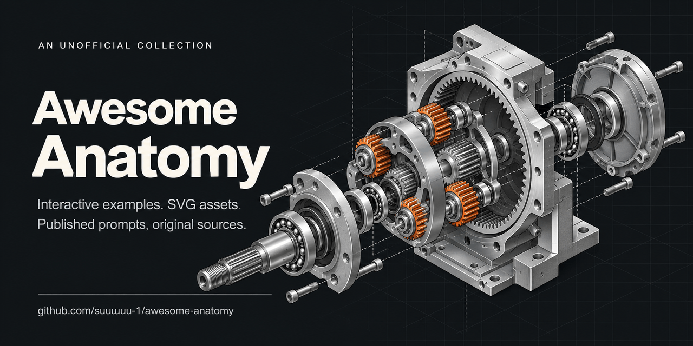

# Awesome Anatomy 

[English](README.md) · [简体中文](README.zh-CN.md)

Interactive machines, visual explainers and SVG assets made with [Anatomy](https://github.com/wheresryan22/anatomy) and its derivatives. Pick a work, open the original, or explore a published prompt.

    

**302 source-linked entries · 36 featured previews · 84 published prompts.** Includes 19 early rendering studies, listed separately.

[Browse all works](docs/catalog.md) · [Published prompts](prompts/index.md) · [Suggest a work](https://github.com/suuuuuu-1/awesome-anatomy/issues/new?template=submit-work.yml)

[Machines &amp; mechanisms](docs/catalog.md#mechanisms) · [Computing &amp; algorithms](docs/catalog.md#computing) · [Physics &amp; energy](docs/catalog.md#physics) · [Life science &amp; materials](docs/catalog.md#biology) · [Architecture &amp; places](docs/catalog.md#architecture) · [Illustration &amp; motion](docs/catalog.md#visual)

Unofficial. Previews stay at their original URLs. Light/dark variants, mirrors and reposts are grouped.

The catalog includes 16 source-only community submissions awaiting upstream review. They are listed separately from the 56 published community-gallery works; a submission is not a hosted demo.

## Featured gallery

Click an image to open the original demo or creator post. SVG entries open the original vector file; showcase entries may provide a video only.

<table>
<tr><td width="33%" align="center" valign="middle"></td><td width="33%" align="center" valign="middle"></td><td width="33%" align="center" valign="middle"></td></tr>
<tr><td align="left" valign="top"><b><a href="docs/catalog.md#specimen-central-nervous-system">Specimen: central nervous system</a></b></td><td align="left" valign="top"><b><a href="docs/catalog.md#jeremy-cpb-advanced">Heart–lung machine: advanced circuit</a></b></td><td align="left" valign="top"><b><a href="docs/catalog.md#zabduziz-parking-gate">Campus parking entrance gate</a></b></td></tr>
<tr><td align="left" valign="top">Julián Olarte · Independent</td><td align="left" valign="top">jeremyl861225 · Independent</td><td align="left" valign="top">Zabduziz · Independent</td></tr>
<tr><td align="left" valign="top">A Spanish-language brain-and-spinal-cord model offers layered disassembly, sections, labels and schematic pathways.</td><td align="left" valign="top">A separate advanced teaching circuit adds a centrifugal arterial pump, assisted venous drainage and blood cardioplegia.</td><td align="left" valign="top">An Indonesian-language gate model traces vehicle detection, identity checks and barrier operation.</td></tr>
<tr><td align="left" valign="top"><a href="https://julianolarteramos.github.io/sistema-nervioso-central/">Original</a> · <a href="https://github.com/julianolarteramos/sistema-nervioso-central/blob/648b03a3ee0d6dafa587dda35e0dbd8c04b8e780/build.mjs">Code</a></td><td align="left" valign="top"><a href="https://jeremyl861225.github.io/heart-lung-machine/cpb-advanced.html">Original</a> · <a href="https://github.com/jeremyl861225/heart-lung-machine/blob/ba2f78fd8787cd88225a62683364ea40f6fb6e75/cpb-advanced.html">Code</a></td><td align="left" valign="top"><a href="https://zabduziz.github.io/parking-anatomy/demo/gerbang-masuk-light.html">Original</a> · <a href="https://github.com/Zabduziz/parking-anatomy/blob/a5e587ec60f7d6a91d3b6bff4293a03f14b8f034/src/build.mjs">Code</a></td></tr>
<tr><td width="33%" align="center" valign="middle"></td><td width="33%" align="center" valign="middle"></td><td width="33%" align="center" valign="middle"></td></tr>
<tr><td align="left" valign="top"><b><a href="docs/catalog.md#dodai-notification-city">Android notification-channel city</a></b></td><td align="left" valign="top"><b><a href="docs/catalog.md#maybeeyes-sagrada-familia">Sagrada Família: interactive disassembly</a></b></td><td align="left" valign="top"><b><a href="docs/catalog.md#laowang-mechanical-keyboard-film">Mechanical keyboard: nine-scene teardown film</a></b></td></tr>
<tr><td align="left" valign="top">Dodai0419 · Independent</td><td align="left" valign="top">maybeeyesnet · Independent</td><td align="left" valign="top">laowang5 · Independent</td></tr>
<tr><td align="left" valign="top">Apps become buildings and notification channels become floors in before/after views of marketing notifications.</td><td align="left" valign="top">An isometric basilica model separates architectural assemblies; inherited Anatomy reference examples are excluded.</td><td align="left" valign="top">A single keyboard film moves through keycaps, switches, Hall sensing, PCB, plate, foam and case.</td></tr>
<tr><td align="left" valign="top"><a href="https://github.com/Dodai0419/notif-city/blob/d9c08f4602d8465feb5ed23232b4b068e184c6ba/docs/before.svg">Original</a> · <a href="https://github.com/Dodai0419/notif-city/blob/d9c08f4602d8465feb5ed23232b4b068e184c6ba/notif_city.mjs">Code</a></td><td align="left" valign="top"><a href="https://maybeeyesnet.github.io/sagrada-familia-anatomy/">Original</a> · <a href="https://github.com/maybeeyesnet/sagrada-familia-anatomy/blob/9998dcafc72967e6780954838e0f4a70af0ab771/index.html">Code</a></td><td align="left" valign="top"><a href="https://github.com/laowang5/anatomy-hyperframes-video/blob/368aa8c3bd0b1fb0c5ba56138f680ee5ae700ec7/projects/mechanical-keyboard/index.html">Original</a> · <a href="https://github.com/laowang5/anatomy-hyperframes-video/blob/368aa8c3bd0b1fb0c5ba56138f680ee5ae700ec7/projects/mechanical-keyboard/geo/build-figures.mjs">Code</a></td></tr>
<tr><td width="33%" align="center" valign="middle"></td><td width="33%" align="center" valign="middle"></td><td width="33%" align="center" valign="middle"></td></tr>
<tr><td align="left" valign="top"><b><a href="docs/catalog.md#everest-searl-seg">Searl Effect Generator: claim-audit model</a></b></td><td align="left" valign="top"><b><a href="docs/catalog.md#optimal-a4-heart">The beating heart</a></b></td><td align="left" valign="top"><b><a href="docs/catalog.md#optimal-a8-muscle-water">Water in and around the fibres</a></b></td></tr>
<tr><td align="left" valign="top">everest-an · Independent</td><td align="left" valign="top">Optimal-Research-Team · Independent</td><td align="left" valign="top">Optimal-Research-Team · Independent</td></tr>
<tr><td align="left" valign="top">A reconstruction separates a speculative machine’s components from its author’s energy and evidence audit.</td><td align="left" valign="top">A health or equipment explainer; see the author’s review status.</td><td align="left" valign="top">A health or equipment explainer; see the author’s review status.</td></tr>
<tr><td align="left" valign="top"><a href="https://github.com/everest-an/searl-seg/blob/5bc145df3f9412837f0403c3a98313acfbfd2d29/searl-seg-light.html">Original</a> · <a href="https://github.com/everest-an/searl-seg/blob/5bc145df3f9412837f0403c3a98313acfbfd2d29/build.mjs">Code</a></td><td align="left" valign="top"><a href="https://optimal-research-team.github.io/optimal-anatomy-figures/a4-heart/heart-light.html">Original</a> · <a href="https://github.com/Optimal-Research-Team/optimal-anatomy-figures/tree/main/figures/a4-heart">Code</a></td><td align="left" valign="top"><a href="https://optimal-research-team.github.io/optimal-anatomy-figures/a8-muscle-water/muscle-water-light.html">Original</a> · <a href="https://github.com/Optimal-Research-Team/optimal-anatomy-figures/tree/main/figures/a8-muscle-water">Code</a></td></tr>
<tr><td width="33%" align="center" valign="middle"></td><td width="33%" align="center" valign="middle"></td><td width="33%" align="center" valign="middle"></td></tr>
<tr><td align="left" valign="top"><b><a href="docs/catalog.md#community-camidev43-engine-lathe">Engine lathe, turning a bar</a></b></td><td align="left" valign="top"><b><a href="docs/catalog.md#luozhu-starship">Starship exploded atlas</a></b></td><td align="left" valign="top"><b><a href="docs/catalog.md#factory-press-shop">Press shop: five-press line</a></b></td></tr>
<tr><td align="left" valign="top">camidev43 · Community</td><td align="left" valign="top">LuozhuZhang · Independent</td><td align="left" valign="top">Senthee / 吴斌 &amp; assistants · Independent</td></tr>
<tr><td align="left" valign="top">A lathe cutaway follows the spindle, tool carriage and bar as the workpiece turns.</td><td align="left" valign="top">An interactive launch-vehicle atlas with separated assemblies, engine details and camera views.</td><td align="left" valign="top">Five linked presses and AGV unloading in an automotive stamping shop.</td></tr>
<tr><td align="left" valign="top"><a href="https://skills.wheresryan.sh/anatomy/community/camidev43/engine-lathe">Original</a> · <a href="https://github.com/wheresryan22/anatomy-community/tree/352c84890fd3cf543b1f69dc9ff3ab7a157c1fe9/figures/camidev43/engine-lathe">Code</a> · <a href="prompts/community-camidev43-engine-lathe.md">Prompt</a></td><td align="left" valign="top"><a href="https://luozhuzhang.github.io/starship-anatomy/">Original</a> · <a href="https://github.com/LuozhuZhang/starship-anatomy/blob/49071a37c2b61eca50099440d62d4e2973bfa412/build.mjs">Code</a></td><td align="left" valign="top"><a href="https://sentheecode.github.io/factory-anatomy/figures/stamping-jier-line-light.html">Original</a> · <a href="https://github.com/Sentheecode/factory-anatomy/blob/b787c2a2493b5764c70bf66fbadbdeabfbc79f51/figures/stamping-jier-line-light.html">Code</a></td></tr>
<tr><td width="33%" align="center" valign="middle"></td><td width="33%" align="center" valign="middle"></td><td width="33%" align="center" valign="middle"></td></tr>
<tr><td align="left" valign="top"><b><a href="docs/catalog.md#specimen-heart">Specimen: heart</a></b></td><td align="left" valign="top"><b><a href="docs/catalog.md#hsiang-network-switch">Eight-port network switch</a></b></td><td align="left" valign="top"><b><a href="docs/catalog.md#changyi-bicycle-derailleur">Eight-speed bicycle rear derailleur</a></b></td></tr>
<tr><td align="left" valign="top">Julián Olarte · Independent</td><td align="left" valign="top">Hsiang-Tang · Independent</td><td align="left" valign="top">changyi123456 · Independent</td></tr>
<tr><td align="left" valign="top">A classroom heart model with beating, chamber cutaways and a pericardium view.</td><td align="left" valign="top">An exploded switch model follows packet forwarding, MAC learning and internal board layers.</td><td align="left" valign="top">A Traditional Chinese interactive derailleur model with gear changes, slow motion and an exploded view.</td></tr>
<tr><td align="left" valign="top"><a href="https://julianolarteramos.github.io/specimen/heart.html">Original</a> · <a href="https://github.com/julianolarteramos/specimen/blob/e15470c272e011528d32a37a2b1697cd2f1e489f/examples/heart/build.mjs">Code</a></td><td align="left" valign="top"><a href="https://hsiang-tang.github.io/network-switch-anatomy/">Original</a> · <a href="https://github.com/Hsiang-Tang/network-switch-anatomy/blob/aaa51f784197547a5c79485abd4d71017253cf08/src/build.mjs">Code</a></td><td align="left" valign="top"><a href="https://changyi123456.github.io/bicycle-derailleur-anatomy/">Original</a> · <a href="https://github.com/changyi123456/bicycle-derailleur-anatomy/blob/dd54c85be59da9648a1d23aa08103a62e6ba3260/index.html">Code</a></td></tr>
<tr><td width="33%" align="center" valign="middle"></td><td width="33%" align="center" valign="middle"></td><td width="33%" align="center" valign="middle"></td></tr>
<tr><td align="left" valign="top"><b><a href="docs/catalog.md#community-zintaen-computer-cpu-alu">From computer to ALU</a></b></td><td align="left" valign="top"><b><a href="docs/catalog.md#community-vinayanand3-wireless-gaming-mouse">Inside a wireless gaming mouse</a></b></td><td align="left" valign="top"><b><a href="docs/catalog.md#cellcog-hydraulic-press">CellCog: Hydraulic press</a></b></td></tr>
<tr><td align="left" valign="top">zintaen · Community</td><td align="left" valign="top">vinayanand3 · Community</td><td align="left" valign="top">CellCog · Independent</td></tr>
<tr><td align="left" valign="top">Zoom from a computer board into a CPU and a four-bit ripple-carry ALU.</td><td align="left" valign="top">An exploded wireless mouse exposes the shell, switches, wheel, sensor and electronics.</td><td align="left" valign="top">Two fluid-linked pistons illustrate pressure and force transmission.</td></tr>
<tr><td align="left" valign="top"><a href="https://skills.wheresryan.sh/anatomy/community/zintaen/computer-cpu-alu">Original</a> · <a href="https://github.com/wheresryan22/anatomy-community/tree/352c84890fd3cf543b1f69dc9ff3ab7a157c1fe9/figures/zintaen/computer-cpu-alu">Code</a> · <a href="prompts/community-zintaen-computer-cpu-alu.md">Prompt</a></td><td align="left" valign="top"><a href="https://skills.wheresryan.sh/anatomy/community/vinayanand3/wireless-gaming-mouse">Original</a> · <a href="https://github.com/wheresryan22/anatomy-community/tree/352c84890fd3cf543b1f69dc9ff3ab7a157c1fe9/figures/vinayanand3/wireless-gaming-mouse">Code</a> · <a href="prompts/community-vinayanand3-wireless-gaming-mouse.md">Prompt</a></td><td align="left" valign="top"><a href="https://cellcog.ai/blog/media/anatomy-claude-skill/gal-hydraulic-press-live.html?v=f6db606f14">Original</a></td></tr>
<tr><td width="33%" align="center" valign="middle"></td><td width="33%" align="center" valign="middle"></td><td width="33%" align="center" valign="middle"></td></tr>
<tr><td align="left" valign="top"><b><a href="docs/catalog.md#amir-lens">Photo lens: focus and iris</a></b></td><td align="left" valign="top"><b><a href="docs/catalog.md#community-taqh-mechanical-keyboard-switch">Keyboard switch, sawn open</a></b></td><td align="left" valign="top"><b><a href="docs/catalog.md#official-watch">Watch movement</a></b></td></tr>
<tr><td align="left" valign="top">Amir Mushich · Independent</td><td align="left" valign="top">taqh · Community</td><td align="left" valign="top">Ryan · Official</td></tr>
<tr><td align="left" valign="top">A threaded carriage moves the lens group while nine iris leaves adjust the opening.</td><td align="left" valign="top">A sawn-open switch exposes the stem, spring and contact mechanism.</td><td align="left" valign="top">Wind the crown, slow time and lift bridges to inspect the watch’s escapement and gear train.</td></tr>
<tr><td align="left" valign="top"><a href="https://anatomy.amirmushich.com/#lens">Original</a> · <a href="https://github.com/amirmushichge/anatomy/blob/1aaaccf519f92eb8f9363984f9a7520851396352/study-catalog.mjs">Code</a></td><td align="left" valign="top"><a href="https://skills.wheresryan.sh/anatomy/community/taqh/mechanical-keyboard-switch">Original</a> · <a href="https://github.com/wheresryan22/anatomy-community/tree/main/figures/taqh/mechanical-keyboard-switch">Code</a> · <a href="prompts/community-taqh-mechanical-keyboard-switch.md">Prompt</a></td><td align="left" valign="top"><a href="https://skills.wheresryan.sh/anatomy/collection/watch">Original</a> · <a href="https://github.com/wheresryan22/anatomy-figures/blob/main/dist/watch.js">Code</a></td></tr>
<tr><td width="33%" align="center" valign="middle"></td><td width="33%" align="center" valign="middle"></td><td width="33%" align="center" valign="middle"></td></tr>
<tr><td align="left" valign="top"><b><a href="docs/catalog.md#rudra-cold-gas-nozzle">Inside a cold-gas nozzle</a></b></td><td align="left" valign="top"><b><a href="docs/catalog.md#amir-hdd">Hard disk drive: seek and park</a></b></td><td align="left" valign="top"><b><a href="docs/catalog.md#salik-robot-hand">Tendon-driven robot hand</a></b></td></tr>
<tr><td align="left" valign="top">Rudrajmehta · Independent</td><td align="left" valign="top">Amir Mushich · Independent</td><td align="left" valign="top">salikshah · Independent</td></tr>
<tr><td align="left" valign="top">A sectioned nozzle bench relates valve state to pressure, Mach number and temperature readouts.</td><td align="left" valign="top">Inspect the platters and head arms, then compare seeking and head parking.</td><td align="left" valign="top">An SVG mechanical-hand study exposes tendon coupling, finger spread and an exploded assembly.</td></tr>
<tr><td align="left" valign="top"><a href="https://github.com/Rudrajmehta/anatomy-cold-gas-nozzle">Original</a> · <a href="https://rudrajmehta.github.io/anatomy-cold-gas-nozzle/">Open demo</a> · <a href="https://github.com/Rudrajmehta/anatomy-cold-gas-nozzle/blob/5fd9079bfc56a5582a6c2ffcd9f07210e168a54e/build.mjs">Code</a></td><td align="left" valign="top"><a href="https://anatomy.amirmushich.com/#hdd">Original</a> · <a href="https://github.com/amirmushichge/anatomy/blob/1aaaccf519f92eb8f9363984f9a7520851396352/study-catalog.mjs">Code</a></td><td align="left" valign="top"><a href="https://github.com/salikshah/robot-hand-anatomy">Original</a> · <a href="https://github.com/salikshah/robot-hand-anatomy/blob/9f5a34bfec845670dd58e438baf2b84b5302c5cb/object/figure-light.html">Code</a></td></tr>
<tr><td width="33%" align="center" valign="middle"></td><td width="33%" align="center" valign="middle"></td><td width="33%" align="center" valign="middle"></td></tr>
<tr><td align="left" valign="top"><b><a href="docs/catalog.md#official-hash-map">Hash map collisions</a></b></td><td align="left" valign="top"><b><a href="docs/catalog.md#meerav-threshold-sieve">Classifier threshold sieve</a></b></td><td align="left" valign="top"><b><a href="docs/catalog.md#wang-gmsl3-link">GMSL3: two independent video-link hops</a></b></td></tr>
<tr><td align="left" valign="top">Ryan · Official</td><td align="left" valign="top">Meerav29 · Independent</td><td align="left" valign="top">wangbrightly · Independent</td></tr>
<tr><td align="left" valign="top">A sorting desk shows keys landing in buckets and collisions accumulating.</td><td align="left" valign="top">Slide a sieve threshold to explore the precision–recall trade-off.</td><td align="left" valign="top">Trace camera-to-screen video, return control traffic and power while comparing two separate channel budgets.</td></tr>
<tr><td align="left" valign="top"><a href="https://skills.wheresryan.sh/anatomy/collection/hash-map">Original</a> · <a href="https://github.com/wheresryan22/anatomy-figures/blob/main/dist/hash-map.js">Code</a></td><td align="left" valign="top"><a href="https://github.com/Meerav29/anatomy-tryouts/tree/main/threshold-sieve">Original</a> · <a href="https://github.com/Meerav29/anatomy-tryouts/blob/a3785b46f1fa8eb2d0f21d61c3be48e54414b60b/threshold-sieve/build.mjs">Code</a></td><td align="left" valign="top"><a href="https://github.com/wangbrightly/gmsl3-link-anatomy">Original</a> · <a href="https://wangbrightly.github.io/gmsl3-link-anatomy/">Open demo</a> · <a href="https://github.com/wangbrightly/gmsl3-link-anatomy/blob/bd8757cd9d00f7bbfee43a1e83f6d2ff11fe03a5/index.html">Code</a></td></tr>
<tr><td width="33%" align="center" valign="middle"></td><td width="33%" align="center" valign="middle"></td><td width="33%" align="center" valign="middle"></td></tr>
<tr><td align="left" valign="top"><b><a href="docs/catalog.md#meerav-accretion">Planetary accretion</a></b></td><td align="left" valign="top"><b><a href="docs/catalog.md#official-seasons">Seasons</a></b></td><td align="left" valign="top"><b><a href="docs/catalog.md#meerav-friction-circle">Tyre friction circle</a></b></td></tr>
<tr><td align="left" valign="top">Meerav29 · Independent</td><td align="left" valign="top">Ryan · Official</td><td align="left" valign="top">Meerav29 · Independent</td></tr>
<tr><td align="left" valign="top">A growing body sweeps up dust, illustrating gravitational focusing.</td><td align="left" valign="top">A moving Earth-and-Sun model explores seasonal illumination.</td><td align="left" valign="top">One grip budget is shared between braking, acceleration and cornering.</td></tr>
<tr><td align="left" valign="top"><a href="https://github.com/Meerav29/anatomy-tryouts/tree/main/accretion">Original</a> · <a href="https://github.com/Meerav29/anatomy-tryouts/blob/a3785b46f1fa8eb2d0f21d61c3be48e54414b60b/accretion/build.mjs">Code</a></td><td align="left" valign="top"><a href="https://skills.wheresryan.sh/anatomy/collection/seasons">Original</a> · <a href="https://github.com/wheresryan22/anatomy-figures/blob/main/dist/seasons.js">Code</a></td><td align="left" valign="top"><a href="https://github.com/Meerav29/anatomy-tryouts/tree/main/friction-circle">Original</a> · <a href="https://github.com/Meerav29/anatomy-tryouts/blob/a3785b46f1fa8eb2d0f21d61c3be48e54414b60b/friction-circle/build.mjs">Code</a></td></tr>
<tr><td width="33%" align="center" valign="middle"></td><td width="33%" align="center" valign="middle"></td><td width="33%" align="center" valign="middle"></td></tr>
<tr><td align="left" valign="top"><b><a href="docs/catalog.md#community-entity-film-projector">Film projector</a></b></td><td align="left" valign="top"><b><a href="docs/catalog.md#cutaway-boxer">Boxer engine</a></b></td><td align="left" valign="top"><b><a href="docs/catalog.md#amir-pen">Click pen: rotary cam</a></b></td></tr>
<tr><td align="left" valign="top">entity · Community</td><td align="left" valign="top">Abhay Kumar · Independent</td><td align="left" valign="top">Amir Mushich · Independent</td></tr>
<tr><td align="left" valign="top">An isometric projector exposes the film-transport mechanism.</td><td align="left" valign="top">Watch opposing pistons move toward and away from the crankshaft.</td><td align="left" valign="top">A rotary cam alternates between ledges and deep slots to latch or release the refill.</td></tr>
<tr><td align="left" valign="top"><a href="https://skills.wheresryan.sh/anatomy/community/entity/film-projector">Original</a> · <a href="https://github.com/wheresryan22/anatomy-community/tree/main/figures/entity/film-projector">Code</a> · <a href="prompts/community-entity-film-projector.md">Prompt</a></td><td align="left" valign="top"><a href="https://github.com/abhay/cutaway/blob/abc8f7af1941d4e724d854a9c1c32905cbe240f3/site/hardware/boxer.mjs">Original</a> · <a href="https://raw.githubusercontent.com/abhay/cutaway/abc8f7af1941d4e724d854a9c1c32905cbe240f3/assets/examples/boxer.svg">Open SVG</a> · <a href="prompts/cutaway-boxer.md">Prompt</a></td><td align="left" valign="top"><a href="https://anatomy.amirmushich.com/#pen">Original</a> · <a href="https://github.com/amirmushichge/anatomy/blob/1aaaccf519f92eb8f9363984f9a7520851396352/study-definitions.mjs">Code</a></td></tr>
<tr><td width="33%" align="center" valign="middle"></td><td width="33%" align="center" valign="middle"></td><td width="33%" align="center" valign="middle"></td></tr>
<tr><td align="left" valign="top"><b><a href="docs/catalog.md#official-turbofan">Turbofan ground run</a></b></td><td align="left" valign="top"><b><a href="docs/catalog.md#community-wheresryan22-raptor-engine">Raptor engine on the test stand</a></b></td><td align="left" valign="top"><b><a href="docs/catalog.md#community-zintaen-geneva-indexing-drive">Geneva indexing drive</a></b></td></tr>
<tr><td align="left" valign="top">Ryan · Official</td><td align="left" valign="top">wheresryan22 · Community</td><td align="left" valign="top">zintaen · Community</td></tr>
<tr><td align="left" valign="top">Change thrust to follow the fan, compressor and turbine in a ground-run engine cutaway.</td><td align="left" valign="top">A rocket engine on a test stand exposes assemblies, pipes and firing effects.</td><td align="left" valign="top">A rotating crank and drive pin advance a four-station Geneva wheel in discrete steps.</td></tr>
<tr><td align="left" valign="top"><a href="https://skills.wheresryan.sh/anatomy/collection/turbofan">Original</a> · <a href="https://github.com/wheresryan22/anatomy-figures/blob/main/dist/turbofan.js">Code</a></td><td align="left" valign="top"><a href="https://skills.wheresryan.sh/anatomy/community/wheresryan22/raptor-engine">Original</a> · <a href="https://github.com/wheresryan22/anatomy-community/tree/main/figures/wheresryan22/raptor-engine">Code</a> · <a href="prompts/community-wheresryan22-raptor-engine.md">Prompt</a></td><td align="left" valign="top"><a href="https://skills.wheresryan.sh/anatomy/community/zintaen/geneva-indexing-drive">Original</a> · <a href="https://github.com/wheresryan22/anatomy-community/tree/352c84890fd3cf543b1f69dc9ff3ab7a157c1fe9/figures/zintaen/geneva-indexing-drive">Code</a> · <a href="prompts/community-zintaen-geneva-indexing-drive.md">Prompt</a></td></tr>
</table>

[Explore the complete catalog →](docs/catalog.md)

## Browse by subject

| Subject | Entries |
|---|---:|
| [Machines &amp; mechanisms](docs/catalog.md#mechanisms) | 109 |
| [Computing &amp; algorithms](docs/catalog.md#computing) | 67 |
| [Physics &amp; energy](docs/catalog.md#physics) | 42 |
| [Life science &amp; materials](docs/catalog.md#biology) | 29 |
| [Architecture &amp; places](docs/catalog.md#architecture) | 6 |
| [Illustration &amp; motion](docs/catalog.md#visual) | 30 |
| [Rendering studies](docs/catalog.md#rendering) | 19 |

## Recently added

2026-10-30: 21 independent works and 16 source-only community submissions added; 15 existing works gained author-hosted previews. The dates below record catalog additions, not the creation dates of the works.

| Added | Work | Creator |
|---|---|---|
| 2026-10-30 | [Bean-to-cup coffee machine](docs/catalog.md#community-azkian1-bean-to-cup-coffee-machine) | azkian1 |
| 2026-10-30 | [Galileo&#x27;s Ring II](docs/catalog.md#community-ericchen0121-galileos-ring-ii) | ericchen0121 |
| 2026-10-30 | [Kaco First Roller heart pen](docs/catalog.md#community-lakhanadewar-kaco-heart-pen) | lakhanadewar |
| 2026-10-30 | [Roadster Inverted Loop Rig](docs/catalog.md#community-zhangyiabc-roadster-loop) | zhangyiabc |
| 2026-10-30 | [GenHTTP: the io_uring exchange](docs/catalog.md#genhttp-01-ioxide-exchange) | IAFahim |
| 2026-10-30 | [Specimen: central nervous system](docs/catalog.md#specimen-central-nervous-system) | Julián Olarte |
| 2026-10-30 | [Stirred-tank CFD workbench](docs/catalog.md#jaydubb-stirred-tank) | jaydubb0513 |
| 2026-10-30 | [Heart–lung machine: advanced circuit](docs/catalog.md#jeremy-cpb-advanced) | jeremyl861225 |
| 2026-10-30 | [Mechanical keyboard: nine-scene teardown film](docs/catalog.md#laowang-mechanical-keyboard-film) | laowang5 |
| 2026-10-30 | [Campus parking entrance gate](docs/catalog.md#zabduziz-parking-gate) | Zabduziz |
| 2026-10-30 | [Shibuya Station reconstruction](docs/catalog.md#kazi-shibuya-reconstruction) | KAZI-ABI |
| 2026-10-30 | [Rocket launch: predict, try, explain](docs/catalog.md#ywedai-rocket-launch) | ywEdAi |

## Start with a published prompt

Each prompt has its own page with the creator, original source, available preview and the published text in a copyable block. We do not invent missing prompts.

[Browse all 84 prompt pages →](prompts/index.md)

Open a work you like, check its original prompt, then adapt it for your own topic. Published text may not capture every revision; a prompt link is not a reproduction guarantee.

## Browse by source

| Source | Entries |
|---|---:|
| [Official Examples](docs/catalog.md#source-official-examples) | 33 |
| [Community Examples](docs/catalog.md#source-community-examples) | 56 |
| [Community Submissions](docs/catalog.md#source-community-submissions) | 16 |
| [Independent Collections](docs/catalog.md#source-independent-collections) | 128 |
| [SVG Assets](docs/catalog.md#source-svg-assets) | 19 |
| [X / Twitter Showcases](docs/catalog.md#source-creator-showcases) | 25 |
| [Reddit Showcases](docs/catalog.md#source-reddit-showcases) | 3 |
| [YouTube Demonstrations](docs/catalog.md#source-youtube-demonstrations) | 2 |
| [Bilibili Demonstrations](docs/catalog.md#source-bilibili-demonstrations) | 1 |
| [Rendering Studies](docs/catalog.md#source-rendering-studies) | 19 |

## Original collections

- [Anatomy Collection](https://skills.wheresryan.sh/anatomy/collection) · [Anatomy Community](https://skills.wheresryan.sh/anatomy/community)
- [GenHTTP machines](https://iafahim.github.io/genhttp-anatomy/) · [Central nervous system](https://julianolarteramos.github.io/sistema-nervioso-central/) · [Parking gate](https://zabduziz.github.io/parking-anatomy/)
- [Factory Anatomy](https://sentheecode.github.io/factory-anatomy/) · [Specimen](https://julianolarteramos.github.io/specimen/) · [CellCog gallery](https://cellcog.ai/blog/anatomy-claude-skill/)
- [Amir Mushich](https://anatomy.amirmushich.com/) · [Meerav29](https://github.com/Meerav29/anatomy-tryouts) · [Studio Little Nice Things](https://anatomy-snowy.vercel.app/)

## Contribute

Made something with Anatomy, or found a work we missed? [Send the original link](https://github.com/suuuuuu-1/awesome-anatomy/issues/new?template=submit-work.yml). A source URL is enough to start; code and a full prompt are optional. Corrections and removal requests are welcome too.

## Credits & reuse

Works remain with their original creators. CC0 covers our original curation only; code, media and published prompts retain their own terms. See [source notices](docs/THIRD_PARTY.md), [contribution notes](CONTRIBUTING.md) and the [machine-readable catalog](data/entries.json).
