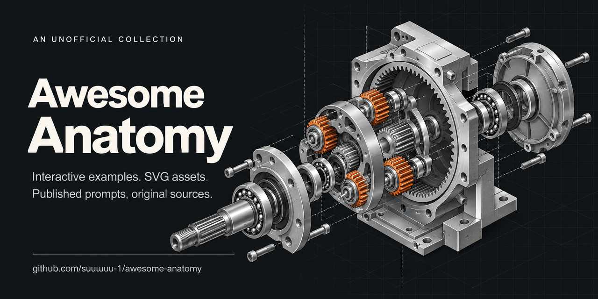

# Awesome Anatomy 

[English](README.md) · [简体中文](README.zh-CN.md)

收集 [Anatomy](https://github.com/wheresryan22/anatomy) 及其衍生项目制作的交互机械、视觉讲解与 SVG 素材。先看作品，再打开原作或查看公开提示词。

    

**302 条带来源记录 · 36 个精选预览 · 84 条公开提示词。** 其中 19 个早期渲染实验单独分类。

[完整作品目录](docs/catalog.zh-CN.md) · [公开提示词](prompts/index.zh-CN.md) · [提交作品](https://github.com/suuuuuu-1/awesome-anatomy/issues/new?template=submit-work.yml)

[机械与拆解](docs/catalog.zh-CN.md#mechanisms) · [计算机与算法](docs/catalog.zh-CN.md#computing) · [物理与能源](docs/catalog.zh-CN.md#physics) · [生命科学与材料](docs/catalog.zh-CN.md#biology) · [建筑与场景](docs/catalog.zh-CN.md#architecture) · [插画与动效](docs/catalog.zh-CN.md#visual)

非官方整理，预览保留在原始地址。明暗版本、镜像与转发合并记录。

目录含 16 条尚待上游审核的源码投稿，与 56 件已发布社区画廊作品分开列出。投稿记录不代表已有在线演示。

## 精选画廊

点击图片打开原始演示或作者帖子。SVG 条目直接打开矢量文件；演示类条目可能只有视频。

<table>
<tr><td width="33%" align="center" valign="middle"></td><td width="33%" align="center" valign="middle"></td><td width="33%" align="center" valign="middle"></td></tr>
<tr><td align="left" valign="top"><b><a href="docs/catalog.zh-CN.md#specimen-central-nervous-system">Specimen: central nervous system</a></b></td><td align="left" valign="top"><b><a href="docs/catalog.zh-CN.md#jeremy-cpb-advanced">Heart–lung machine: advanced circuit</a></b></td><td align="left" valign="top"><b><a href="docs/catalog.zh-CN.md#zabduziz-parking-gate">Campus parking entrance gate</a></b></td></tr>
<tr><td align="left" valign="top">Julián Olarte · 独立创作者作品</td><td align="left" valign="top">jeremyl861225 · 独立创作者作品</td><td align="left" valign="top">Zabduziz · 独立创作者作品</td></tr>
<tr><td align="left" valign="top">西班牙语脑与脊髓模型，提供分层拆解、切面、标注与示意性神经通路。</td><td align="left" valign="top">独立的进阶教学回路，加入离心动脉泵、辅助静脉引流与血液心麻痹液路径。</td><td align="left" valign="top">印度尼西亚语停车入口模型，串联车辆检测、身份核验与道闸动作。</td></tr>
<tr><td align="left" valign="top"><a href="https://julianolarteramos.github.io/sistema-nervioso-central/">原作</a> · <a href="https://github.com/julianolarteramos/sistema-nervioso-central/blob/648b03a3ee0d6dafa587dda35e0dbd8c04b8e780/build.mjs">源码</a></td><td align="left" valign="top"><a href="https://jeremyl861225.github.io/heart-lung-machine/cpb-advanced.html">原作</a> · <a href="https://github.com/jeremyl861225/heart-lung-machine/blob/ba2f78fd8787cd88225a62683364ea40f6fb6e75/cpb-advanced.html">源码</a></td><td align="left" valign="top"><a href="https://zabduziz.github.io/parking-anatomy/demo/gerbang-masuk-light.html">原作</a> · <a href="https://github.com/Zabduziz/parking-anatomy/blob/a5e587ec60f7d6a91d3b6bff4293a03f14b8f034/src/build.mjs">源码</a></td></tr>
<tr><td width="33%" align="center" valign="middle"></td><td width="33%" align="center" valign="middle"></td><td width="33%" align="center" valign="middle"></td></tr>
<tr><td align="left" valign="top"><b><a href="docs/catalog.zh-CN.md#dodai-notification-city">Android notification-channel city</a></b></td><td align="left" valign="top"><b><a href="docs/catalog.zh-CN.md#maybeeyes-sagrada-familia">Sagrada Família: interactive disassembly</a></b></td><td align="left" valign="top"><b><a href="docs/catalog.zh-CN.md#laowang-mechanical-keyboard-film">Mechanical keyboard: nine-scene teardown film</a></b></td></tr>
<tr><td align="left" valign="top">Dodai0419 · 独立创作者作品</td><td align="left" valign="top">maybeeyesnet · 独立创作者作品</td><td align="left" valign="top">laowang5 · 独立创作者作品</td></tr>
<tr><td align="left" valign="top">将应用画成楼宇、通知渠道画成楼层，对照营销通知清理前后的变化。</td><td align="left" valign="top">等轴测大教堂模型，可分离建筑总成；仓库内继承的 Anatomy 示例不重复收录。</td><td align="left" valign="top">一部键盘拆解影片，依次展示键帽、轴体、霍尔感应、电路板、定位板、消音棉与外壳。</td></tr>
<tr><td align="left" valign="top"><a href="https://github.com/Dodai0419/notif-city/blob/d9c08f4602d8465feb5ed23232b4b068e184c6ba/docs/before.svg">原作</a> · <a href="https://github.com/Dodai0419/notif-city/blob/d9c08f4602d8465feb5ed23232b4b068e184c6ba/notif_city.mjs">源码</a></td><td align="left" valign="top"><a href="https://maybeeyesnet.github.io/sagrada-familia-anatomy/">原作</a> · <a href="https://github.com/maybeeyesnet/sagrada-familia-anatomy/blob/9998dcafc72967e6780954838e0f4a70af0ab771/index.html">源码</a></td><td align="left" valign="top"><a href="https://github.com/laowang5/anatomy-hyperframes-video/blob/368aa8c3bd0b1fb0c5ba56138f680ee5ae700ec7/projects/mechanical-keyboard/index.html">原作</a> · <a href="https://github.com/laowang5/anatomy-hyperframes-video/blob/368aa8c3bd0b1fb0c5ba56138f680ee5ae700ec7/projects/mechanical-keyboard/geo/build-figures.mjs">源码</a></td></tr>
<tr><td width="33%" align="center" valign="middle"></td><td width="33%" align="center" valign="middle"></td><td width="33%" align="center" valign="middle"></td></tr>
<tr><td align="left" valign="top"><b><a href="docs/catalog.zh-CN.md#everest-searl-seg">Searl Effect Generator: claim-audit model</a></b></td><td align="left" valign="top"><b><a href="docs/catalog.zh-CN.md#optimal-a4-heart">The beating heart</a></b></td><td align="left" valign="top"><b><a href="docs/catalog.zh-CN.md#optimal-a8-muscle-water">Water in and around the fibres</a></b></td></tr>
<tr><td align="left" valign="top">everest-an · 独立创作者作品</td><td align="left" valign="top">Optimal-Research-Team · 独立创作者作品</td><td align="left" valign="top">Optimal-Research-Team · 独立创作者作品</td></tr>
<tr><td align="left" valign="top">将推测性装置的结构重建与作者的能量、证据审计分开展示，不作为装置可行性的证明。</td><td align="left" valign="top">A health or equipment explainer; see the author’s review status.</td><td align="left" valign="top">A health or equipment explainer; see the author’s review status.</td></tr>
<tr><td align="left" valign="top"><a href="https://github.com/everest-an/searl-seg/blob/5bc145df3f9412837f0403c3a98313acfbfd2d29/searl-seg-light.html">原作</a> · <a href="https://github.com/everest-an/searl-seg/blob/5bc145df3f9412837f0403c3a98313acfbfd2d29/build.mjs">源码</a></td><td align="left" valign="top"><a href="https://optimal-research-team.github.io/optimal-anatomy-figures/a4-heart/heart-light.html">原作</a> · <a href="https://github.com/Optimal-Research-Team/optimal-anatomy-figures/tree/main/figures/a4-heart">源码</a></td><td align="left" valign="top"><a href="https://optimal-research-team.github.io/optimal-anatomy-figures/a8-muscle-water/muscle-water-light.html">原作</a> · <a href="https://github.com/Optimal-Research-Team/optimal-anatomy-figures/tree/main/figures/a8-muscle-water">源码</a></td></tr>
<tr><td width="33%" align="center" valign="middle"></td><td width="33%" align="center" valign="middle"></td><td width="33%" align="center" valign="middle"></td></tr>
<tr><td align="left" valign="top"><b><a href="docs/catalog.zh-CN.md#community-camidev43-engine-lathe">Engine lathe, turning a bar</a></b></td><td align="left" valign="top"><b><a href="docs/catalog.zh-CN.md#luozhu-starship">Starship exploded atlas</a></b></td><td align="left" valign="top"><b><a href="docs/catalog.zh-CN.md#factory-press-shop">Press shop: five-press line</a></b></td></tr>
<tr><td align="left" valign="top">camidev43 · 社区作品</td><td align="left" valign="top">LuozhuZhang · 独立创作者作品</td><td align="left" valign="top">Senthee / 吴斌 &amp; assistants · 独立创作者作品</td></tr>
<tr><td align="left" valign="top">车床剖视展示主轴、刀架与工件的车削过程。</td><td align="left" valign="top">可交互的运载飞行器结构图，展示分离总成、发动机细节与多种观察视角。</td><td align="left" valign="top">整车冲压车间的五连压力机与 AGV 下料。</td></tr>
<tr><td align="left" valign="top"><a href="https://skills.wheresryan.sh/anatomy/community/camidev43/engine-lathe">原作</a> · <a href="https://github.com/wheresryan22/anatomy-community/tree/352c84890fd3cf543b1f69dc9ff3ab7a157c1fe9/figures/camidev43/engine-lathe">源码</a> · <a href="prompts/community-camidev43-engine-lathe.md">提示词</a></td><td align="left" valign="top"><a href="https://luozhuzhang.github.io/starship-anatomy/">原作</a> · <a href="https://github.com/LuozhuZhang/starship-anatomy/blob/49071a37c2b61eca50099440d62d4e2973bfa412/build.mjs">源码</a></td><td align="left" valign="top"><a href="https://sentheecode.github.io/factory-anatomy/figures/stamping-jier-line-light.html">原作</a> · <a href="https://github.com/Sentheecode/factory-anatomy/blob/b787c2a2493b5764c70bf66fbadbdeabfbc79f51/figures/stamping-jier-line-light.html">源码</a></td></tr>
<tr><td width="33%" align="center" valign="middle"></td><td width="33%" align="center" valign="middle"></td><td width="33%" align="center" valign="middle"></td></tr>
<tr><td align="left" valign="top"><b><a href="docs/catalog.zh-CN.md#specimen-heart">Specimen: heart</a></b></td><td align="left" valign="top"><b><a href="docs/catalog.zh-CN.md#hsiang-network-switch">Eight-port network switch</a></b></td><td align="left" valign="top"><b><a href="docs/catalog.zh-CN.md#changyi-bicycle-derailleur">Eight-speed bicycle rear derailleur</a></b></td></tr>
<tr><td align="left" valign="top">Julián Olarte · 独立创作者作品</td><td align="left" valign="top">Hsiang-Tang · 独立创作者作品</td><td align="left" valign="top">changyi123456 · 独立创作者作品</td></tr>
<tr><td align="left" valign="top">心脏教学模型，包含搏动、心腔剖面与心包视图。</td><td align="left" valign="top">交换机爆炸模型，展示数据包转发、MAC 学习与内部板层。</td><td align="left" valign="top">繁体中文自行车后变速器模型，包含换挡、慢动作与爆炸视图。</td></tr>
<tr><td align="left" valign="top"><a href="https://julianolarteramos.github.io/specimen/heart.html">原作</a> · <a href="https://github.com/julianolarteramos/specimen/blob/e15470c272e011528d32a37a2b1697cd2f1e489f/examples/heart/build.mjs">源码</a></td><td align="left" valign="top"><a href="https://hsiang-tang.github.io/network-switch-anatomy/">原作</a> · <a href="https://github.com/Hsiang-Tang/network-switch-anatomy/blob/aaa51f784197547a5c79485abd4d71017253cf08/src/build.mjs">源码</a></td><td align="left" valign="top"><a href="https://changyi123456.github.io/bicycle-derailleur-anatomy/">原作</a> · <a href="https://github.com/changyi123456/bicycle-derailleur-anatomy/blob/dd54c85be59da9648a1d23aa08103a62e6ba3260/index.html">源码</a></td></tr>
<tr><td width="33%" align="center" valign="middle"></td><td width="33%" align="center" valign="middle"></td><td width="33%" align="center" valign="middle"></td></tr>
<tr><td align="left" valign="top"><b><a href="docs/catalog.zh-CN.md#community-zintaen-computer-cpu-alu">From computer to ALU</a></b></td><td align="left" valign="top"><b><a href="docs/catalog.zh-CN.md#community-vinayanand3-wireless-gaming-mouse">Inside a wireless gaming mouse</a></b></td><td align="left" valign="top"><b><a href="docs/catalog.zh-CN.md#cellcog-hydraulic-press">CellCog: Hydraulic press</a></b></td></tr>
<tr><td align="left" valign="top">zintaen · 社区作品</td><td align="left" valign="top">vinayanand3 · 社区作品</td><td align="left" valign="top">CellCog · 独立创作者作品</td></tr>
<tr><td align="left" valign="top">由计算机主板逐层放大至 CPU 与四位行波进位 ALU。</td><td align="left" valign="top">无线鼠标爆炸图，展开外壳、微动、滚轮、传感器与电路。</td><td align="left" valign="top">两个由液体连接的活塞演示压力与力的传递。</td></tr>
<tr><td align="left" valign="top"><a href="https://skills.wheresryan.sh/anatomy/community/zintaen/computer-cpu-alu">原作</a> · <a href="https://github.com/wheresryan22/anatomy-community/tree/352c84890fd3cf543b1f69dc9ff3ab7a157c1fe9/figures/zintaen/computer-cpu-alu">源码</a> · <a href="prompts/community-zintaen-computer-cpu-alu.md">提示词</a></td><td align="left" valign="top"><a href="https://skills.wheresryan.sh/anatomy/community/vinayanand3/wireless-gaming-mouse">原作</a> · <a href="https://github.com/wheresryan22/anatomy-community/tree/352c84890fd3cf543b1f69dc9ff3ab7a157c1fe9/figures/vinayanand3/wireless-gaming-mouse">源码</a> · <a href="prompts/community-vinayanand3-wireless-gaming-mouse.md">提示词</a></td><td align="left" valign="top"><a href="https://cellcog.ai/blog/media/anatomy-claude-skill/gal-hydraulic-press-live.html?v=f6db606f14">原作</a></td></tr>
<tr><td width="33%" align="center" valign="middle"></td><td width="33%" align="center" valign="middle"></td><td width="33%" align="center" valign="middle"></td></tr>
<tr><td align="left" valign="top"><b><a href="docs/catalog.zh-CN.md#amir-lens">Photo lens: focus and iris</a></b></td><td align="left" valign="top"><b><a href="docs/catalog.zh-CN.md#community-taqh-mechanical-keyboard-switch">Keyboard switch, sawn open</a></b></td><td align="left" valign="top"><b><a href="docs/catalog.zh-CN.md#official-watch">Watch movement</a></b></td></tr>
<tr><td align="left" valign="top">Amir Mushich · 独立创作者作品</td><td align="left" valign="top">taqh · 社区作品</td><td align="left" valign="top">Ryan · 官方作品</td></tr>
<tr><td align="left" valign="top">对焦螺纹推动镜组移动，九片光圈叶片联动改变通光孔径。</td><td align="left" valign="top">剖开的机械轴体展示轴心、弹簧与触点机构。</td><td align="left" valign="top">上弦、放慢时间并抬起夹板，查看擒纵机构与轮系。</td></tr>
<tr><td align="left" valign="top"><a href="https://anatomy.amirmushich.com/#lens">原作</a> · <a href="https://github.com/amirmushichge/anatomy/blob/1aaaccf519f92eb8f9363984f9a7520851396352/study-catalog.mjs">源码</a></td><td align="left" valign="top"><a href="https://skills.wheresryan.sh/anatomy/community/taqh/mechanical-keyboard-switch">原作</a> · <a href="https://github.com/wheresryan22/anatomy-community/tree/main/figures/taqh/mechanical-keyboard-switch">源码</a> · <a href="prompts/community-taqh-mechanical-keyboard-switch.md">提示词</a></td><td align="left" valign="top"><a href="https://skills.wheresryan.sh/anatomy/collection/watch">原作</a> · <a href="https://github.com/wheresryan22/anatomy-figures/blob/main/dist/watch.js">源码</a></td></tr>
<tr><td width="33%" align="center" valign="middle"></td><td width="33%" align="center" valign="middle"></td><td width="33%" align="center" valign="middle"></td></tr>
<tr><td align="left" valign="top"><b><a href="docs/catalog.zh-CN.md#rudra-cold-gas-nozzle">Inside a cold-gas nozzle</a></b></td><td align="left" valign="top"><b><a href="docs/catalog.zh-CN.md#amir-hdd">Hard disk drive: seek and park</a></b></td><td align="left" valign="top"><b><a href="docs/catalog.zh-CN.md#salik-robot-hand">Tendon-driven robot hand</a></b></td></tr>
<tr><td align="left" valign="top">Rudrajmehta · 独立创作者作品</td><td align="left" valign="top">Amir Mushich · 独立创作者作品</td><td align="left" valign="top">salikshah · 独立创作者作品</td></tr>
<tr><td align="left" valign="top">剖开的喷管试验台展示阀门状态与压力、马赫数、温度读数的关系。</td><td align="left" valign="top">拆看盘片与磁头臂，比较寻道和磁头停泊过程。</td><td align="left" valign="top">SVG 机械手演示呈现肌腱耦合、手指张合与零件爆炸拆解。</td></tr>
<tr><td align="left" valign="top"><a href="https://github.com/Rudrajmehta/anatomy-cold-gas-nozzle">原作</a> · <a href="https://rudrajmehta.github.io/anatomy-cold-gas-nozzle/">打开演示</a> · <a href="https://github.com/Rudrajmehta/anatomy-cold-gas-nozzle/blob/5fd9079bfc56a5582a6c2ffcd9f07210e168a54e/build.mjs">源码</a></td><td align="left" valign="top"><a href="https://anatomy.amirmushich.com/#hdd">原作</a> · <a href="https://github.com/amirmushichge/anatomy/blob/1aaaccf519f92eb8f9363984f9a7520851396352/study-catalog.mjs">源码</a></td><td align="left" valign="top"><a href="https://github.com/salikshah/robot-hand-anatomy">原作</a> · <a href="https://github.com/salikshah/robot-hand-anatomy/blob/9f5a34bfec845670dd58e438baf2b84b5302c5cb/object/figure-light.html">源码</a></td></tr>
<tr><td width="33%" align="center" valign="middle"></td><td width="33%" align="center" valign="middle"></td><td width="33%" align="center" valign="middle"></td></tr>
<tr><td align="left" valign="top"><b><a href="docs/catalog.zh-CN.md#official-hash-map">Hash map collisions</a></b></td><td align="left" valign="top"><b><a href="docs/catalog.zh-CN.md#meerav-threshold-sieve">Classifier threshold sieve</a></b></td><td align="left" valign="top"><b><a href="docs/catalog.zh-CN.md#wang-gmsl3-link">GMSL3: two independent video-link hops</a></b></td></tr>
<tr><td align="left" valign="top">Ryan · 官方作品</td><td align="left" valign="top">Meerav29 · 独立创作者作品</td><td align="left" valign="top">wangbrightly · 独立创作者作品</td></tr>
<tr><td align="left" valign="top">用分拣台呈现键值落桶与碰撞堆叠。</td><td align="left" valign="top">滑动筛选阈值，比较分类器精确率与召回率的取舍。</td><td align="left" valign="top">追踪摄像头到屏幕的视频、反向控制和供电，对比两跳独立信道的预算。</td></tr>
<tr><td align="left" valign="top"><a href="https://skills.wheresryan.sh/anatomy/collection/hash-map">原作</a> · <a href="https://github.com/wheresryan22/anatomy-figures/blob/main/dist/hash-map.js">源码</a></td><td align="left" valign="top"><a href="https://github.com/Meerav29/anatomy-tryouts/tree/main/threshold-sieve">原作</a> · <a href="https://github.com/Meerav29/anatomy-tryouts/blob/a3785b46f1fa8eb2d0f21d61c3be48e54414b60b/threshold-sieve/build.mjs">源码</a></td><td align="left" valign="top"><a href="https://github.com/wangbrightly/gmsl3-link-anatomy">原作</a> · <a href="https://wangbrightly.github.io/gmsl3-link-anatomy/">打开演示</a> · <a href="https://github.com/wangbrightly/gmsl3-link-anatomy/blob/bd8757cd9d00f7bbfee43a1e83f6d2ff11fe03a5/index.html">源码</a></td></tr>
<tr><td width="33%" align="center" valign="middle"></td><td width="33%" align="center" valign="middle"></td><td width="33%" align="center" valign="middle"></td></tr>
<tr><td align="left" valign="top"><b><a href="docs/catalog.zh-CN.md#meerav-accretion">Planetary accretion</a></b></td><td align="left" valign="top"><b><a href="docs/catalog.zh-CN.md#official-seasons">Seasons</a></b></td><td align="left" valign="top"><b><a href="docs/catalog.zh-CN.md#meerav-friction-circle">Tyre friction circle</a></b></td></tr>
<tr><td align="left" valign="top">Meerav29 · 独立创作者作品</td><td align="left" valign="top">Ryan · 官方作品</td><td align="left" valign="top">Meerav29 · 独立创作者作品</td></tr>
<tr><td align="left" valign="top">用天体扫过尘埃的过程解释行星吸积与引力聚焦。</td><td align="left" valign="top">用运动的日地模型观察季节性光照变化。</td><td align="left" valign="top">用同一份轮胎抓地预算解释制动、加速与转弯之间的取舍。</td></tr>
<tr><td align="left" valign="top"><a href="https://github.com/Meerav29/anatomy-tryouts/tree/main/accretion">原作</a> · <a href="https://github.com/Meerav29/anatomy-tryouts/blob/a3785b46f1fa8eb2d0f21d61c3be48e54414b60b/accretion/build.mjs">源码</a></td><td align="left" valign="top"><a href="https://skills.wheresryan.sh/anatomy/collection/seasons">原作</a> · <a href="https://github.com/wheresryan22/anatomy-figures/blob/main/dist/seasons.js">源码</a></td><td align="left" valign="top"><a href="https://github.com/Meerav29/anatomy-tryouts/tree/main/friction-circle">原作</a> · <a href="https://github.com/Meerav29/anatomy-tryouts/blob/a3785b46f1fa8eb2d0f21d61c3be48e54414b60b/friction-circle/build.mjs">源码</a></td></tr>
<tr><td width="33%" align="center" valign="middle"></td><td width="33%" align="center" valign="middle"></td><td width="33%" align="center" valign="middle"></td></tr>
<tr><td align="left" valign="top"><b><a href="docs/catalog.zh-CN.md#community-entity-film-projector">Film projector</a></b></td><td align="left" valign="top"><b><a href="docs/catalog.zh-CN.md#cutaway-boxer">Boxer engine</a></b></td><td align="left" valign="top"><b><a href="docs/catalog.zh-CN.md#amir-pen">Click pen: rotary cam</a></b></td></tr>
<tr><td align="left" valign="top">entity · 社区作品</td><td align="left" valign="top">Abhay Kumar · 独立创作者作品</td><td align="left" valign="top">Amir Mushich · 独立创作者作品</td></tr>
<tr><td align="left" valign="top">等轴测放映机展示胶片输送机构。</td><td align="left" valign="top">查看水平对置活塞、连杆与曲轴的相位关系。</td><td align="left" valign="top">旋转凸轮在台阶和深槽之间切换，解释笔芯如何按下锁定、再按弹回。</td></tr>
<tr><td align="left" valign="top"><a href="https://skills.wheresryan.sh/anatomy/community/entity/film-projector">原作</a> · <a href="https://github.com/wheresryan22/anatomy-community/tree/main/figures/entity/film-projector">源码</a> · <a href="prompts/community-entity-film-projector.md">提示词</a></td><td align="left" valign="top"><a href="https://github.com/abhay/cutaway/blob/abc8f7af1941d4e724d854a9c1c32905cbe240f3/site/hardware/boxer.mjs">原作</a> · <a href="https://raw.githubusercontent.com/abhay/cutaway/abc8f7af1941d4e724d854a9c1c32905cbe240f3/assets/examples/boxer.svg">打开 SVG</a> · <a href="prompts/cutaway-boxer.md">提示词</a></td><td align="left" valign="top"><a href="https://anatomy.amirmushich.com/#pen">原作</a> · <a href="https://github.com/amirmushichge/anatomy/blob/1aaaccf519f92eb8f9363984f9a7520851396352/study-definitions.mjs">源码</a></td></tr>
<tr><td width="33%" align="center" valign="middle"></td><td width="33%" align="center" valign="middle"></td><td width="33%" align="center" valign="middle"></td></tr>
<tr><td align="left" valign="top"><b><a href="docs/catalog.zh-CN.md#official-turbofan">Turbofan ground run</a></b></td><td align="left" valign="top"><b><a href="docs/catalog.zh-CN.md#community-wheresryan22-raptor-engine">Raptor engine on the test stand</a></b></td><td align="left" valign="top"><b><a href="docs/catalog.zh-CN.md#community-zintaen-geneva-indexing-drive">Geneva indexing drive</a></b></td></tr>
<tr><td align="left" valign="top">Ryan · 官方作品</td><td align="left" valign="top">wheresryan22 · 社区作品</td><td align="left" valign="top">zintaen · 社区作品</td></tr>
<tr><td align="left" valign="top">改变推力，查看地面试车中的风扇、压气机与涡轮。</td><td align="left" valign="top">试验台上的火箭发动机展示总成、管路与点火效果。</td><td align="left" valign="top">连续旋转的曲柄与驱动销带动四工位槽轮间歇分度。</td></tr>
<tr><td align="left" valign="top"><a href="https://skills.wheresryan.sh/anatomy/collection/turbofan">原作</a> · <a href="https://github.com/wheresryan22/anatomy-figures/blob/main/dist/turbofan.js">源码</a></td><td align="left" valign="top"><a href="https://skills.wheresryan.sh/anatomy/community/wheresryan22/raptor-engine">原作</a> · <a href="https://github.com/wheresryan22/anatomy-community/tree/main/figures/wheresryan22/raptor-engine">源码</a> · <a href="prompts/community-wheresryan22-raptor-engine.md">提示词</a></td><td align="left" valign="top"><a href="https://skills.wheresryan.sh/anatomy/community/zintaen/geneva-indexing-drive">原作</a> · <a href="https://github.com/wheresryan22/anatomy-community/tree/352c84890fd3cf543b1f69dc9ff3ab7a157c1fe9/figures/zintaen/geneva-indexing-drive">源码</a> · <a href="prompts/community-zintaen-geneva-indexing-drive.md">提示词</a></td></tr>
</table>

[查看完整目录 →](docs/catalog.zh-CN.md)

## 按主题浏览

| 主题 | 条目 |
|---|---:|
| [机械与拆解](docs/catalog.zh-CN.md#mechanisms) | 109 |
| [计算机与算法](docs/catalog.zh-CN.md#computing) | 67 |
| [物理与能源](docs/catalog.zh-CN.md#physics) | 42 |
| [生命科学与材料](docs/catalog.zh-CN.md#biology) | 29 |
| [建筑与场景](docs/catalog.zh-CN.md#architecture) | 6 |
| [插画与动效](docs/catalog.zh-CN.md#visual) | 30 |
| [早期渲染实验](docs/catalog.zh-CN.md#rendering) | 19 |

## 最近收录

2026-10-30：新增 21 条独立作品与 16 条仅源码的社区投稿，并为 15 条已有作品补上作者预览图。下列日期表示本站收录日期，不是作品创建时间。

| 收录日期 | 作品 | 作者 |
|---|---|---|
| 2026-10-30 | [Bean-to-cup coffee machine](docs/catalog.zh-CN.md#community-azkian1-bean-to-cup-coffee-machine) | azkian1 |
| 2026-10-30 | [Galileo&#x27;s Ring II](docs/catalog.zh-CN.md#community-ericchen0121-galileos-ring-ii) | ericchen0121 |
| 2026-10-30 | [Kaco First Roller heart pen](docs/catalog.zh-CN.md#community-lakhanadewar-kaco-heart-pen) | lakhanadewar |
| 2026-10-30 | [Roadster Inverted Loop Rig](docs/catalog.zh-CN.md#community-zhangyiabc-roadster-loop) | zhangyiabc |
| 2026-10-30 | [GenHTTP: the io_uring exchange](docs/catalog.zh-CN.md#genhttp-01-ioxide-exchange) | IAFahim |
| 2026-10-30 | [Specimen: central nervous system](docs/catalog.zh-CN.md#specimen-central-nervous-system) | Julián Olarte |
| 2026-10-30 | [Stirred-tank CFD workbench](docs/catalog.zh-CN.md#jaydubb-stirred-tank) | jaydubb0513 |
| 2026-10-30 | [Heart–lung machine: advanced circuit](docs/catalog.zh-CN.md#jeremy-cpb-advanced) | jeremyl861225 |
| 2026-10-30 | [Mechanical keyboard: nine-scene teardown film](docs/catalog.zh-CN.md#laowang-mechanical-keyboard-film) | laowang5 |
| 2026-10-30 | [Campus parking entrance gate](docs/catalog.zh-CN.md#zabduziz-parking-gate) | Zabduziz |
| 2026-10-30 | [Shibuya Station reconstruction](docs/catalog.zh-CN.md#kazi-shibuya-reconstruction) | KAZI-ABI |
| 2026-10-30 | [Rocket launch: predict, try, explain](docs/catalog.zh-CN.md#ywedai-rocket-launch) | ywEdAi |

## 从公开提示词开始

每条提示词独立成页，保留作者、原始出处、可用预览和方便复制的公开文本。不补写作者没有公布的提示词。

[查看全部 84 条提示词 →](prompts/index.zh-CN.md)

先找喜欢的作品，再查看原始提示词并改成自己的题材。公开文本未必包含全部修改过程，有提示词不代表一遍就能复现。

## 按来源浏览

| 来源 | 条目 |
|---|---:|
| [官方作品](docs/catalog.zh-CN.md#source-official-examples) | 33 |
| [社区作品](docs/catalog.zh-CN.md#source-community-examples) | 56 |
| [待审核社区投稿](docs/catalog.zh-CN.md#source-community-submissions) | 16 |
| [独立创作者作品](docs/catalog.zh-CN.md#source-independent-collections) | 128 |
| [SVG 素材](docs/catalog.zh-CN.md#source-svg-assets) | 19 |
| [X / Twitter 演示](docs/catalog.zh-CN.md#source-creator-showcases) | 25 |
| [Reddit 演示](docs/catalog.zh-CN.md#source-reddit-showcases) | 3 |
| [YouTube 演示](docs/catalog.zh-CN.md#source-youtube-demonstrations) | 2 |
| [B 站演示](docs/catalog.zh-CN.md#source-bilibili-demonstrations) | 1 |
| [早期渲染实验](docs/catalog.zh-CN.md#source-rendering-studies) | 19 |

## 原始资源入口

- [Anatomy Collection](https://skills.wheresryan.sh/anatomy/collection) · [Anatomy Community](https://skills.wheresryan.sh/anatomy/community)
- [GenHTTP machines](https://iafahim.github.io/genhttp-anatomy/) · [Central nervous system](https://julianolarteramos.github.io/sistema-nervioso-central/) · [Parking gate](https://zabduziz.github.io/parking-anatomy/)
- [Factory Anatomy](https://sentheecode.github.io/factory-anatomy/) · [Specimen](https://julianolarteramos.github.io/specimen/) · [CellCog gallery](https://cellcog.ai/blog/anatomy-claude-skill/)
- [Amir Mushich](https://anatomy.amirmushich.com/) · [Meerav29](https://github.com/Meerav29/anatomy-tryouts) · [Studio Little Nice Things](https://anatomy-snowy.vercel.app/)

## 参与整理

做过 Anatomy 作品，或发现我们遗漏的案例？[把原始链接发来](https://github.com/suuuuuu-1/awesome-anatomy/issues/new?template=submit-work.yml)就可以，源码和完整提示词不是必填项。也欢迎纠错和申请移除。

## 署名与复用

作品归原作者所有。CC0 仅适用于我们原创的整理文字与元数据；代码、媒体和公开提示词保留各自条款。详见[来源说明](docs/THIRD_PARTY.md)、[贡献指南](CONTRIBUTING.md)与[结构化数据](data/entries.json)。
