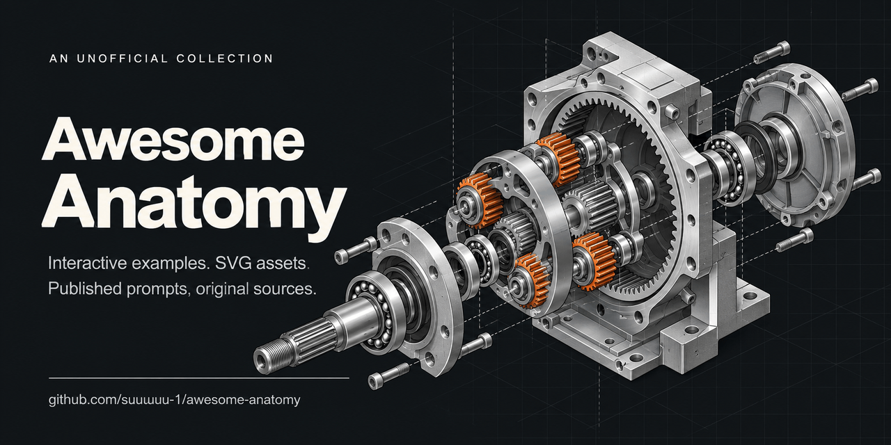

# Awesome Anatomy 

[English](README.md) · [简体中文](README.zh-CN.md)

收集 [Anatomy](https://github.com/wheresryan22/anatomy) 及其衍生项目制作的交互机械、视觉讲解与 SVG 素材。先看作品，再打开原作或查看公开提示词。

    

**217 条带来源记录 · 36 个精选预览 · 59 条公开提示词。** 其中 19 个早期渲染实验单独分类。

[完整作品目录](docs/catalog.zh-CN.md) · [公开提示词](prompts/index.zh-CN.md) · [提交作品](https://github.com/suuuuuu-1/awesome-anatomy/issues/new?template=submit-work.yml)

[机械与拆解](docs/catalog.zh-CN.md#mechanisms) · [计算机与算法](docs/catalog.zh-CN.md#computing) · [物理与能源](docs/catalog.zh-CN.md#physics) · [生命科学与材料](docs/catalog.zh-CN.md#biology) · [建筑与场景](docs/catalog.zh-CN.md#architecture) · [插画与动效](docs/catalog.zh-CN.md#visual)

非官方整理，预览保留在原始地址。明暗版本、镜像与转发合并记录。

## 精选画廊

点击图片打开原始演示或作者帖子。SVG 条目直接打开矢量文件；演示类条目可能只有视频。

<table>
<tr><td width="33%" align="center" valign="middle"></td><td width="33%" align="center" valign="middle"></td><td width="33%" align="center" valign="middle"></td></tr>
<tr><td align="left" valign="top"><b><a href="docs/catalog.zh-CN.md#amir-lens">Photo lens: focus and iris</a></b></td><td align="left" valign="top"><b><a href="docs/catalog.zh-CN.md#community-taqh-mechanical-keyboard-switch">Keyboard switch, sawn open</a></b></td><td align="left" valign="top"><b><a href="docs/catalog.zh-CN.md#official-watch">Watch movement</a></b></td></tr>
<tr><td align="left" valign="top">Amir Mushich · 独立创作者作品</td><td align="left" valign="top">taqh · 社区作品</td><td align="left" valign="top">Ryan · 官方作品</td></tr>
<tr><td align="left" valign="top">对焦螺纹推动镜组移动，九片光圈叶片联动改变通光孔径。</td><td align="left" valign="top">剖开的机械轴体展示轴心、弹簧与触点机构。</td><td align="left" valign="top">上弦、放慢时间并抬起夹板，查看擒纵机构与轮系。</td></tr>
<tr><td align="left" valign="top"><a href="https://anatomy.amirmushich.com/#lens">原作</a> · <a href="https://github.com/amirmushichge/anatomy/blob/1aaaccf519f92eb8f9363984f9a7520851396352/study-catalog.mjs">源码</a></td><td align="left" valign="top"><a href="https://skills.wheresryan.sh/anatomy/community/taqh/mechanical-keyboard-switch">原作</a> · <a href="https://github.com/wheresryan22/anatomy-community/tree/main/figures/taqh/mechanical-keyboard-switch">源码</a> · <a href="prompts/community-taqh-mechanical-keyboard-switch.md">提示词</a></td><td align="left" valign="top"><a href="https://skills.wheresryan.sh/anatomy/collection/watch">原作</a> · <a href="https://github.com/wheresryan22/anatomy-figures/blob/main/dist/watch.js">源码</a></td></tr>
<tr><td width="33%" align="center" valign="middle"></td><td width="33%" align="center" valign="middle"></td><td width="33%" align="center" valign="middle"></td></tr>
<tr><td align="left" valign="top"><b><a href="docs/catalog.zh-CN.md#rudra-cold-gas-nozzle">Inside a cold-gas nozzle</a></b></td><td align="left" valign="top"><b><a href="docs/catalog.zh-CN.md#amir-hdd">Hard disk drive: seek and park</a></b></td><td align="left" valign="top"><b><a href="docs/catalog.zh-CN.md#salik-robot-hand">Tendon-driven robot hand</a></b></td></tr>
<tr><td align="left" valign="top">Rudrajmehta · 独立创作者作品</td><td align="left" valign="top">Amir Mushich · 独立创作者作品</td><td align="left" valign="top">salikshah · 独立创作者作品</td></tr>
<tr><td align="left" valign="top">剖开的喷管试验台展示阀门状态与压力、马赫数、温度读数的关系。</td><td align="left" valign="top">拆看盘片与磁头臂，比较寻道和磁头停泊过程。</td><td align="left" valign="top">SVG 机械手演示呈现肌腱耦合、手指张合与零件爆炸拆解。</td></tr>
<tr><td align="left" valign="top"><a href="https://github.com/Rudrajmehta/anatomy-cold-gas-nozzle">原作</a> · <a href="https://rudrajmehta.github.io/anatomy-cold-gas-nozzle/">打开演示</a> · <a href="https://github.com/Rudrajmehta/anatomy-cold-gas-nozzle/blob/5fd9079bfc56a5582a6c2ffcd9f07210e168a54e/build.mjs">源码</a></td><td align="left" valign="top"><a href="https://anatomy.amirmushich.com/#hdd">原作</a> · <a href="https://github.com/amirmushichge/anatomy/blob/1aaaccf519f92eb8f9363984f9a7520851396352/study-catalog.mjs">源码</a></td><td align="left" valign="top"><a href="https://github.com/salikshah/robot-hand-anatomy">原作</a> · <a href="https://github.com/salikshah/robot-hand-anatomy/blob/9f5a34bfec845670dd58e438baf2b84b5302c5cb/object/figure-light.html">源码</a></td></tr>
<tr><td width="33%" align="center" valign="middle"></td><td width="33%" align="center" valign="middle"></td><td width="33%" align="center" valign="middle"></td></tr>
<tr><td align="left" valign="top"><b><a href="docs/catalog.zh-CN.md#official-hash-map">Hash map collisions</a></b></td><td align="left" valign="top"><b><a href="docs/catalog.zh-CN.md#meerav-threshold-sieve">Classifier threshold sieve</a></b></td><td align="left" valign="top"><b><a href="docs/catalog.zh-CN.md#wang-gmsl3-link">GMSL3: two independent video-link hops</a></b></td></tr>
<tr><td align="left" valign="top">Ryan · 官方作品</td><td align="left" valign="top">Meerav29 · 独立创作者作品</td><td align="left" valign="top">wangbrightly · 独立创作者作品</td></tr>
<tr><td align="left" valign="top">用分拣台呈现键值落桶与碰撞堆叠。</td><td align="left" valign="top">滑动筛选阈值，比较分类器精确率与召回率的取舍。</td><td align="left" valign="top">追踪摄像头到屏幕的视频、反向控制和供电，对比两跳独立信道的预算。</td></tr>
<tr><td align="left" valign="top"><a href="https://skills.wheresryan.sh/anatomy/collection/hash-map">原作</a> · <a href="https://github.com/wheresryan22/anatomy-figures/blob/main/dist/hash-map.js">源码</a></td><td align="left" valign="top"><a href="https://github.com/Meerav29/anatomy-tryouts/tree/main/threshold-sieve">原作</a> · <a href="https://github.com/Meerav29/anatomy-tryouts/blob/a3785b46f1fa8eb2d0f21d61c3be48e54414b60b/threshold-sieve/build.mjs">源码</a></td><td align="left" valign="top"><a href="https://github.com/wangbrightly/gmsl3-link-anatomy">原作</a> · <a href="https://wangbrightly.github.io/gmsl3-link-anatomy/">打开演示</a> · <a href="https://github.com/wangbrightly/gmsl3-link-anatomy/blob/bd8757cd9d00f7bbfee43a1e83f6d2ff11fe03a5/index.html">源码</a></td></tr>
<tr><td width="33%" align="center" valign="middle"></td><td width="33%" align="center" valign="middle"></td><td width="33%" align="center" valign="middle"></td></tr>
<tr><td align="left" valign="top"><b><a href="docs/catalog.zh-CN.md#meerav-accretion">Planetary accretion</a></b></td><td align="left" valign="top"><b><a href="docs/catalog.zh-CN.md#official-seasons">Seasons</a></b></td><td align="left" valign="top"><b><a href="docs/catalog.zh-CN.md#meerav-friction-circle">Tyre friction circle</a></b></td></tr>
<tr><td align="left" valign="top">Meerav29 · 独立创作者作品</td><td align="left" valign="top">Ryan · 官方作品</td><td align="left" valign="top">Meerav29 · 独立创作者作品</td></tr>
<tr><td align="left" valign="top">用天体扫过尘埃的过程解释行星吸积与引力聚焦。</td><td align="left" valign="top">用运动的日地模型观察季节性光照变化。</td><td align="left" valign="top">用同一份轮胎抓地预算解释制动、加速与转弯之间的取舍。</td></tr>
<tr><td align="left" valign="top"><a href="https://github.com/Meerav29/anatomy-tryouts/tree/main/accretion">原作</a> · <a href="https://github.com/Meerav29/anatomy-tryouts/blob/a3785b46f1fa8eb2d0f21d61c3be48e54414b60b/accretion/build.mjs">源码</a></td><td align="left" valign="top"><a href="https://skills.wheresryan.sh/anatomy/collection/seasons">原作</a> · <a href="https://github.com/wheresryan22/anatomy-figures/blob/main/dist/seasons.js">源码</a></td><td align="left" valign="top"><a href="https://github.com/Meerav29/anatomy-tryouts/tree/main/friction-circle">原作</a> · <a href="https://github.com/Meerav29/anatomy-tryouts/blob/a3785b46f1fa8eb2d0f21d61c3be48e54414b60b/friction-circle/build.mjs">源码</a></td></tr>
<tr><td width="33%" align="center" valign="middle"></td><td width="33%" align="center" valign="middle"></td><td width="33%" align="center" valign="middle"></td></tr>
<tr><td align="left" valign="top"><b><a href="docs/catalog.zh-CN.md#community-entity-film-projector">Film projector</a></b></td><td align="left" valign="top"><b><a href="docs/catalog.zh-CN.md#cutaway-boxer">Boxer engine</a></b></td><td align="left" valign="top"><b><a href="docs/catalog.zh-CN.md#amir-pen">Click pen: rotary cam</a></b></td></tr>
<tr><td align="left" valign="top">entity · 社区作品</td><td align="left" valign="top">Abhay Kumar · 独立创作者作品</td><td align="left" valign="top">Amir Mushich · 独立创作者作品</td></tr>
<tr><td align="left" valign="top">等轴测放映机展示胶片输送机构。</td><td align="left" valign="top">查看水平对置活塞、连杆与曲轴的相位关系。</td><td align="left" valign="top">旋转凸轮在台阶和深槽之间切换，解释笔芯如何按下锁定、再按弹回。</td></tr>
<tr><td align="left" valign="top"><a href="https://skills.wheresryan.sh/anatomy/community/entity/film-projector">原作</a> · <a href="https://github.com/wheresryan22/anatomy-community/tree/main/figures/entity/film-projector">源码</a> · <a href="prompts/community-entity-film-projector.md">提示词</a></td><td align="left" valign="top"><a href="https://github.com/abhay/cutaway/blob/abc8f7af1941d4e724d854a9c1c32905cbe240f3/site/hardware/boxer.mjs">原作</a> · <a href="https://raw.githubusercontent.com/abhay/cutaway/abc8f7af1941d4e724d854a9c1c32905cbe240f3/assets/examples/boxer.svg">打开 SVG</a> · <a href="prompts/cutaway-boxer.md">提示词</a></td><td align="left" valign="top"><a href="https://anatomy.amirmushich.com/#pen">原作</a> · <a href="https://github.com/amirmushichge/anatomy/blob/1aaaccf519f92eb8f9363984f9a7520851396352/study-definitions.mjs">源码</a></td></tr>
<tr><td width="33%" align="center" valign="middle"></td><td width="33%" align="center" valign="middle"></td><td width="33%" align="center" valign="middle"></td></tr>
<tr><td align="left" valign="top"><b><a href="docs/catalog.zh-CN.md#official-turbofan">Turbofan ground run</a></b></td><td align="left" valign="top"><b><a href="docs/catalog.zh-CN.md#community-wheresryan22-raptor-engine">Raptor engine on the test stand</a></b></td><td align="left" valign="top"><b><a href="docs/catalog.zh-CN.md#rudra-cold-gas-thrusters">Cold-gas attitude-control thrusters</a></b></td></tr>
<tr><td align="left" valign="top">Ryan · 官方作品</td><td align="left" valign="top">wheresryan22 · 社区作品</td><td align="left" valign="top">Rudrajmehta · 独立创作者作品</td></tr>
<tr><td align="left" valign="top">改变推力，查看地面试车中的风扇、压气机与涡轮。</td><td align="left" valign="top">试验台上的火箭发动机展示总成、管路与点火效果。</td><td align="left" valign="top">两组相向推进器在试验台上驱动并停止火箭舱段的转动。</td></tr>
<tr><td align="left" valign="top"><a href="https://skills.wheresryan.sh/anatomy/collection/turbofan">原作</a> · <a href="https://github.com/wheresryan22/anatomy-figures/blob/main/dist/turbofan.js">源码</a></td><td align="left" valign="top"><a href="https://skills.wheresryan.sh/anatomy/community/wheresryan22/raptor-engine">原作</a> · <a href="https://github.com/wheresryan22/anatomy-community/tree/main/figures/wheresryan22/raptor-engine">源码</a> · <a href="prompts/community-wheresryan22-raptor-engine.md">提示词</a></td><td align="left" valign="top"><a href="https://github.com/Rudrajmehta/anatomy-cold-gas-thrusters">原作</a> · <a href="https://rudrajmehta.github.io/anatomy-cold-gas-thrusters/">打开演示</a> · <a href="https://github.com/Rudrajmehta/anatomy-cold-gas-thrusters/blob/c1334f927ca707d82173461c59231d5ee3560baf/build.mjs">源码</a></td></tr>
<tr><td width="33%" align="center" valign="middle"></td><td width="33%" align="center" valign="middle"></td><td width="33%" align="center" valign="middle"></td></tr>
<tr><td align="left" valign="top"><b><a href="docs/catalog.zh-CN.md#meerav-chai-boilover">Why milk boils over</a></b></td><td align="left" valign="top"><b><a href="docs/catalog.zh-CN.md#community-entity-lever-espresso-machine">Lever espresso machine</a></b></td><td align="left" valign="top"><b><a href="docs/catalog.zh-CN.md#uncle-saleh-robot">Uncle Saleh robot: CAD cutaway</a></b></td></tr>
<tr><td align="left" valign="top">Meerav29 · 独立创作者作品</td><td align="left" valign="top">entity · 社区作品</td><td align="left" valign="top">modigmd · 独立创作者作品</td></tr>
<tr><td align="left" valign="top">比较牛奶表皮困住蒸汽与清水沸腾，解释溢锅现象。</td><td align="left" valign="top">杠杆咖啡机展示手动冲煮机构。</td><td align="left" valign="top">查看站立机器人保留的 CAD 零件，对照手、手臂、肩部与头部的动作展示。</td></tr>
<tr><td align="left" valign="top"><a href="https://github.com/Meerav29/anatomy-tryouts/tree/main/chai-boilover">原作</a> · <a href="https://github.com/Meerav29/anatomy-tryouts/blob/a3785b46f1fa8eb2d0f21d61c3be48e54414b60b/chai-boilover/build.mjs">源码</a></td><td align="left" valign="top"><a href="https://skills.wheresryan.sh/anatomy/community/entity/lever-espresso-machine">原作</a> · <a href="https://github.com/wheresryan22/anatomy-community/tree/main/figures/entity/lever-espresso-machine">源码</a> · <a href="prompts/community-entity-lever-espresso-machine.md">提示词</a></td><td align="left" valign="top"><a href="https://github.com/modigmd/uncle-saleh-anatomy">原作</a> · <a href="https://modigmd.github.io/uncle-saleh-anatomy/">打开演示</a> · <a href="https://github.com/modigmd/uncle-saleh-anatomy/blob/027ba592daeb8f69db1ae3cd763b42bcb06e6ebc/Uncle-Saleh-Anatomy.html">源码</a></td></tr>
<tr><td width="33%" align="center" valign="middle"></td><td width="33%" align="center" valign="middle"></td><td width="33%" align="center" valign="middle"></td></tr>
<tr><td align="left" valign="top"><b><a href="docs/catalog.zh-CN.md#official-bloom-filter">Bloom filter</a></b></td><td align="left" valign="top"><b><a href="docs/catalog.zh-CN.md#official-message-queue">Message queue</a></b></td><td align="left" valign="top"><b><a href="docs/catalog.zh-CN.md#official-rate-limiter">Token bucket</a></b></td></tr>
<tr><td align="left" valign="top">Ryan · 官方作品</td><td align="left" valign="top">Ryan · 官方作品</td><td align="left" valign="top">Ryan · 官方作品</td></tr>
<tr><td align="left" valign="top">三个转轮和一排标记演示“可能存在”与“确定不存在”。</td><td align="left" valign="top">用弹珠轨道展示消息按顺序等待并通过闸门。</td><td align="left" valign="top">用代币分发装置解释突发容量与请求限流。</td></tr>
<tr><td align="left" valign="top"><a href="https://skills.wheresryan.sh/anatomy/collection/bloom-filter">原作</a> · <a href="https://github.com/wheresryan22/anatomy-figures/blob/main/dist/bloom-filter.js">源码</a></td><td align="left" valign="top"><a href="https://skills.wheresryan.sh/anatomy/collection/message-queue">原作</a> · <a href="https://github.com/wheresryan22/anatomy-figures/blob/main/dist/message-queue.js">源码</a></td><td align="left" valign="top"><a href="https://skills.wheresryan.sh/anatomy/collection/rate-limiter">原作</a> · <a href="https://github.com/wheresryan22/anatomy-figures/blob/main/dist/rate-limiter.js">源码</a></td></tr>
<tr><td width="33%" align="center" valign="middle"></td><td width="33%" align="center" valign="middle"></td><td width="33%" align="center" valign="middle"></td></tr>
<tr><td align="left" valign="top"><b><a href="docs/catalog.zh-CN.md#asset-aero-vertiport">Air taxi vertiport</a></b></td><td align="left" valign="top"><b><a href="docs/catalog.zh-CN.md#asset-energy-turbine">Wind turbine</a></b></td><td align="left" valign="top"><b><a href="docs/catalog.zh-CN.md#asset-synth-hero">Synthesizer hero</a></b></td></tr>
<tr><td align="left" valign="top">Teddarific · SVG 素材</td><td align="left" valign="top">Teddarific · SVG 素材</td><td align="left" valign="top">Teddarific · SVG 素材</td></tr>
<tr><td align="left" valign="top">Teddarific 制作的独立 SVG 插画，附原始文件、源码及主题版本。</td><td align="left" valign="top">Teddarific 制作的独立 SVG 插画，附原始文件、源码及主题版本。</td><td align="left" valign="top">Teddarific 制作的独立 SVG 插画，附原始文件、源码及主题版本。</td></tr>
<tr><td align="left" valign="top"><a href="https://github.com/Teddarific/skills/blob/7e897b2c35b4b6c5a70410d9e4a976efa288d265/skills/anatomy-asset/examples/aero-vertiport/aero-vertiport-light.svg">原作</a> · <a href="https://raw.githubusercontent.com/Teddarific/skills/7e897b2c35b4b6c5a70410d9e4a976efa288d265/skills/anatomy-asset/examples/aero-vertiport/aero-vertiport-light.svg">打开 SVG</a> · <a href="https://github.com/Teddarific/skills/blob/7e897b2c35b4b6c5a70410d9e4a976efa288d265/skills/anatomy-asset/examples/aero-vertiport/build.mjs">源码</a></td><td align="left" valign="top"><a href="https://github.com/Teddarific/skills/blob/7e897b2c35b4b6c5a70410d9e4a976efa288d265/skills/anatomy-asset/examples/energy-turbine/energy-turbine.svg">原作</a> · <a href="https://raw.githubusercontent.com/Teddarific/skills/7e897b2c35b4b6c5a70410d9e4a976efa288d265/skills/anatomy-asset/examples/energy-turbine/energy-turbine.svg">打开 SVG</a> · <a href="https://github.com/Teddarific/skills/blob/7e897b2c35b4b6c5a70410d9e4a976efa288d265/skills/anatomy-asset/examples/energy-turbine/build.mjs">源码</a></td><td align="left" valign="top"><a href="https://github.com/Teddarific/skills/blob/7e897b2c35b4b6c5a70410d9e4a976efa288d265/skills/anatomy-asset/examples/synth-hero/synth-hero-light.svg">原作</a> · <a href="https://raw.githubusercontent.com/Teddarific/skills/7e897b2c35b4b6c5a70410d9e4a976efa288d265/skills/anatomy-asset/examples/synth-hero/synth-hero-light.svg">打开 SVG</a> · <a href="https://github.com/Teddarific/skills/blob/7e897b2c35b4b6c5a70410d9e4a976efa288d265/skills/anatomy-asset/examples/synth-hero/build.mjs">源码</a></td></tr>
<tr><td width="33%" align="center" valign="middle"></td><td width="33%" align="center" valign="middle"></td><td width="33%" align="center" valign="middle"></td></tr>
<tr><td align="left" valign="top"><b><a href="docs/catalog.zh-CN.md#community-tiago-varandas-bmw-ix3-on-the-bench">BMW iX3 on the bench</a></b></td><td align="left" valign="top"><b><a href="docs/catalog.zh-CN.md#official-tokamak">Tokamak shot</a></b></td><td align="left" valign="top"><b><a href="docs/catalog.zh-CN.md#community-wheresryan22-ripple-tank">Ripple tank</a></b></td></tr>
<tr><td align="left" valign="top">tiago-varandas · 社区作品</td><td align="left" valign="top">Ryan · 官方作品</td><td align="left" valign="top">wheresryan22 · 社区作品</td></tr>
<tr><td align="left" valign="top">试验台上的模型车提供总成拆解、行驶及充电演示。</td><td align="left" valign="top">等轴测托卡马克示意呈现一次等离子体放电。</td><td align="left" valign="top">课堂波纹水槽展示振源运动与水面波纹的关系。</td></tr>
<tr><td align="left" valign="top"><a href="https://skills.wheresryan.sh/anatomy/community/tiago-varandas/bmw-ix3-on-the-bench">原作</a> · <a href="https://github.com/wheresryan22/anatomy-community/tree/main/figures/tiago-varandas/bmw-ix3-on-the-bench">源码</a> · <a href="prompts/community-tiago-varandas-bmw-ix3-on-the-bench.md">提示词</a></td><td align="left" valign="top"><a href="https://skills.wheresryan.sh/anatomy/collection/tokamak">原作</a> · <a href="https://github.com/wheresryan22/anatomy-figures/blob/main/dist/tokamak.js">源码</a></td><td align="left" valign="top"><a href="https://skills.wheresryan.sh/anatomy/community/wheresryan22/ripple-tank">原作</a> · <a href="https://github.com/wheresryan22/anatomy-community/tree/main/figures/wheresryan22/ripple-tank">源码</a> · <a href="prompts/community-wheresryan22-ripple-tank.md">提示词</a></td></tr>
<tr><td width="33%" align="center" valign="middle"></td><td width="33%" align="center" valign="middle"></td><td width="33%" align="center" valign="middle"></td></tr>
<tr><td align="left" valign="top"><b><a href="docs/catalog.zh-CN.md#x-jshguo-2110354465731891426">How an LLM chooses the next token</a></b></td><td align="left" valign="top"><b><a href="docs/catalog.zh-CN.md#x-dani_avila7-2109317963811574099">How the Egyptian pyramids were built</a></b></td><td align="left" valign="top"><b><a href="docs/catalog.zh-CN.md#cutaway-jet-engine">GE9X jet engine</a></b></td></tr>
<tr><td align="left" valign="top">jshguo · X / Twitter 演示</td><td align="left" valign="top">dani_avila7 · X / Twitter 演示</td><td align="left" valign="top">Abhay Kumar · 独立创作者作品</td></tr>
<tr><td align="left" valign="top">借用 Anatomy 的图解展示注意力、投票、softmax 与采样过程。</td><td align="left" valign="top">附有简短原始 Anatomy 提示词的金字塔建造讲解。</td><td align="left" valign="top">GE9X 教学剖面图，对照核心气流、旁通气流与各级转动部件。</td></tr>
<tr><td align="left" valign="top"><a href="https://x.com/jshguo/status/2110354465731891426">原作</a></td><td align="left" valign="top"><a href="https://x.com/dani_avila7/status/2109317963811574099">原作</a> · <a href="prompts/x-dani_avila7-2109317963811574099.md">提示词</a></td><td align="left" valign="top"><a href="https://github.com/abhay/cutaway/blob/abc8f7af1941d4e724d854a9c1c32905cbe240f3/site/hardware/jet-engine.mjs">原作</a> · <a href="https://raw.githubusercontent.com/abhay/cutaway/abc8f7af1941d4e724d854a9c1c32905cbe240f3/assets/examples/jet-engine.svg">打开 SVG</a> · <a href="prompts/cutaway-jet-engine.md">提示词</a></td></tr>
<tr><td width="33%" align="center" valign="middle"></td><td width="33%" align="center" valign="middle"></td><td width="33%" align="center" valign="middle"></td></tr>
<tr><td align="left" valign="top"><b><a href="docs/catalog.zh-CN.md#community-minhaajre-powerbank-anatomy">Powerbank anatomy: how a 25,000 mAh 200 W powerbank works</a></b></td><td align="left" valign="top"><b><a href="docs/catalog.zh-CN.md#meerav-ackermann">Ackermann steering</a></b></td><td align="left" valign="top"><b><a href="docs/catalog.zh-CN.md#amir-watch">Mechanical watch: winding and escapement</a></b></td></tr>
<tr><td align="left" valign="top">minhaajre · 社区作品</td><td align="left" valign="top">Meerav29 · 独立创作者作品</td><td align="left" valign="top">Amir Mushich · 独立创作者作品</td></tr>
<tr><td align="left" valign="top">充电宝剖面说明电芯、电能转换与输出硬件的布局。</td><td align="left" valign="top">通过内外轮不同转角，解释四个车轮怎样绕同一转弯中心运动。</td><td align="left" valign="top">给机械表上弦，逐步查看擒纵机构与齿轮传动。</td></tr>
<tr><td align="left" valign="top"><a href="https://skills.wheresryan.sh/anatomy/community/minhaajre/powerbank-anatomy">原作</a> · <a href="https://github.com/wheresryan22/anatomy-community/tree/main/figures/minhaajre/powerbank-anatomy">源码</a> · <a href="prompts/community-minhaajre-powerbank-anatomy.md">提示词</a></td><td align="left" valign="top"><a href="https://github.com/Meerav29/anatomy-tryouts/tree/main/ackermann">原作</a> · <a href="https://github.com/Meerav29/anatomy-tryouts/blob/a3785b46f1fa8eb2d0f21d61c3be48e54414b60b/ackermann/build.mjs">源码</a></td><td align="left" valign="top"><a href="https://anatomy.amirmushich.com/#watch">原作</a> · <a href="https://github.com/amirmushichge/anatomy/blob/1aaaccf519f92eb8f9363984f9a7520851396352/study-definitions.mjs">源码</a></td></tr>
</table>

[查看完整目录 →](docs/catalog.zh-CN.md)

## 按主题浏览

| 主题 | 条目 |
|---|---:|
| [机械与拆解](docs/catalog.zh-CN.md#mechanisms) | 79 |
| [计算机与算法](docs/catalog.zh-CN.md#computing) | 48 |
| [物理与能源](docs/catalog.zh-CN.md#physics) | 21 |
| [生命科学与材料](docs/catalog.zh-CN.md#biology) | 21 |
| [建筑与场景](docs/catalog.zh-CN.md#architecture) | 2 |
| [插画与动效](docs/catalog.zh-CN.md#visual) | 27 |
| [早期渲染实验](docs/catalog.zh-CN.md#rendering) | 19 |

## 最近收录

2026-10-18：从独立 Anatomy 作品集与 X 原帖补入 49 条记录。下列日期表示本站收录日期，不是作品创建时间。

| 收录日期 | 作品 | 作者 |
|---|---|---|
| 2026-10-18 | [Photo lens: focus and iris](docs/catalog.zh-CN.md#amir-lens) | Amir Mushich |
| 2026-10-18 | [Planetary accretion](docs/catalog.zh-CN.md#meerav-accretion) | Meerav29 |
| 2026-10-18 | [Anatomy of a DJ booth](docs/catalog.zh-CN.md#tiago-dj-booth) | Tiago Varandas / Studio Little Nice Things |
| 2026-10-18 | [Inside a cold-gas nozzle](docs/catalog.zh-CN.md#rudra-cold-gas-nozzle) | Rudrajmehta |
| 2026-10-18 | [Uncle Saleh robot: CAD cutaway](docs/catalog.zh-CN.md#uncle-saleh-robot) | modigmd |
| 2026-10-18 | [Tendon-driven robot hand](docs/catalog.zh-CN.md#salik-robot-hand) | salikshah |
| 2026-10-18 | [GMSL3: two independent video-link hops](docs/catalog.zh-CN.md#wang-gmsl3-link) | wangbrightly |
| 2026-10-18 | [Scrum sprint as a working machine](docs/catalog.zh-CN.md#iepyon-scrum-sprint) | iepyon |
| 2026-10-18 | [GE9X jet engine](docs/catalog.zh-CN.md#cutaway-jet-engine) | Abhay Kumar |
| 2026-10-18 | [How an LLM chooses the next token](docs/catalog.zh-CN.md#x-jshguo-2110354465731891426) | jshguo |

## 从公开提示词开始

每条提示词独立成页，保留作者、原始出处、可用预览和方便复制的公开文本。不补写作者没有公布的提示词。

[查看全部 59 条提示词 →](prompts/index.zh-CN.md)

先找喜欢的作品，再查看原始提示词并改成自己的题材。公开文本未必包含全部修改过程，有提示词不代表一遍就能复现。

## 按来源浏览

| 来源 | 条目 |
|---|---:|
| [官方作品](docs/catalog.zh-CN.md#source-official-examples) | 33 |
| [社区作品](docs/catalog.zh-CN.md#source-community-examples) | 47 |
| [独立创作者作品](docs/catalog.zh-CN.md#source-independent-collections) | 68 |
| [SVG 素材](docs/catalog.zh-CN.md#source-svg-assets) | 19 |
| [X / Twitter 演示](docs/catalog.zh-CN.md#source-creator-showcases) | 25 |
| [Reddit 演示](docs/catalog.zh-CN.md#source-reddit-showcases) | 3 |
| [YouTube 演示](docs/catalog.zh-CN.md#source-youtube-demonstrations) | 2 |
| [B 站演示](docs/catalog.zh-CN.md#source-bilibili-demonstrations) | 1 |
| [早期渲染实验](docs/catalog.zh-CN.md#source-rendering-studies) | 19 |

## 原始资源入口

- [Anatomy Collection](https://skills.wheresryan.sh/anatomy/collection) · [Anatomy Community](https://skills.wheresryan.sh/anatomy/community)
- [Amir Mushich](https://anatomy.amirmushich.com/) · [Meerav29](https://github.com/Meerav29/anatomy-tryouts) · [Studio Little Nice Things](https://anatomy-snowy.vercel.app/)

## 参与整理

做过 Anatomy 作品，或发现我们遗漏的案例？[把原始链接发来](https://github.com/suuuuuu-1/awesome-anatomy/issues/new?template=submit-work.yml)就可以，源码和完整提示词不是必填项。也欢迎纠错和申请移除。

## 署名与复用

作品归原作者所有。CC0 仅适用于我们原创的整理文字与元数据；代码、媒体和公开提示词保留各自条款。详见[来源说明](docs/THIRD_PARTY.md)、[贡献指南](CONTRIBUTING.md)与[结构化数据](data/entries.json)。
